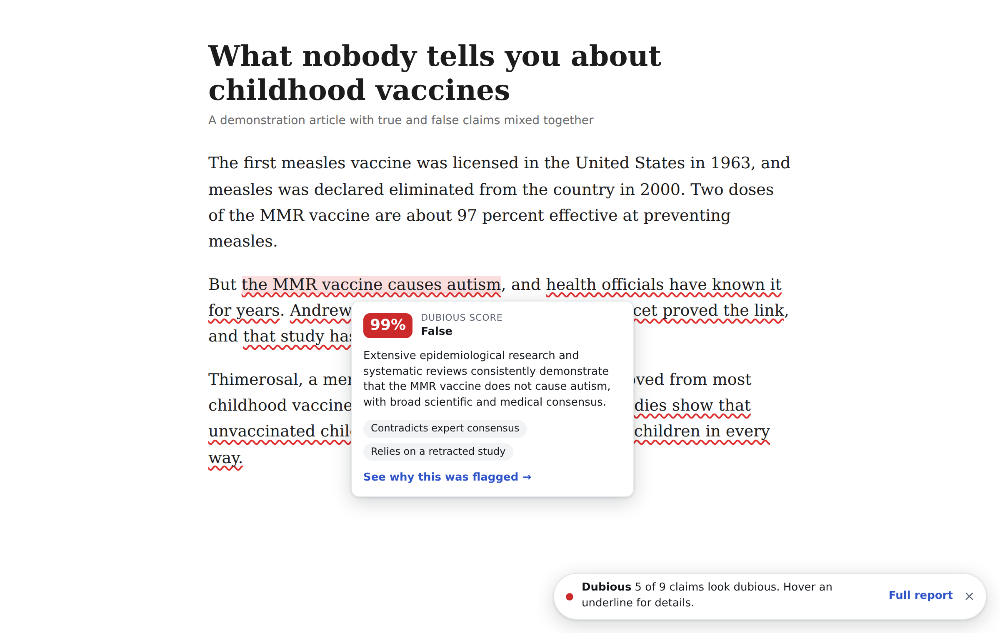
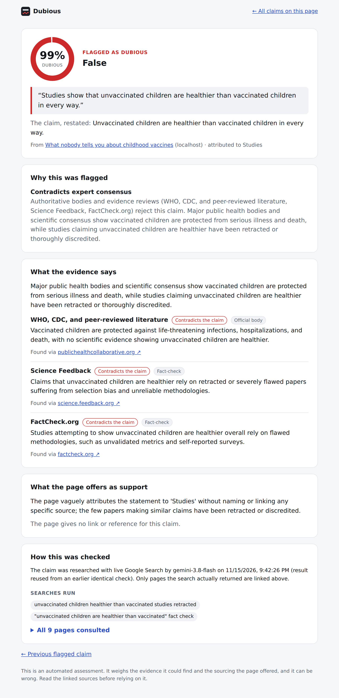
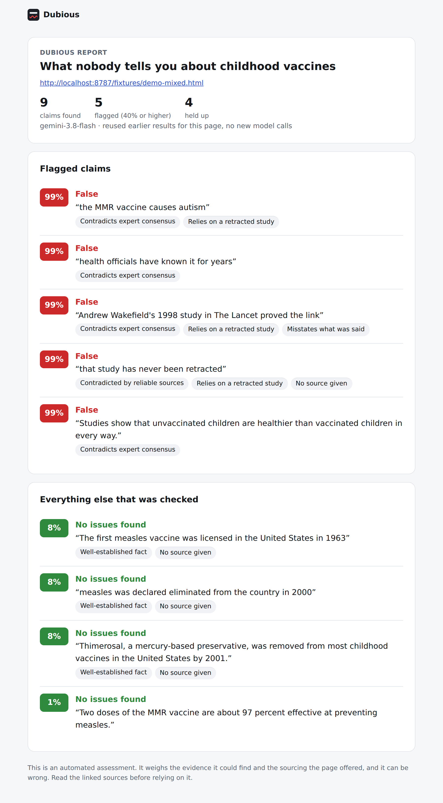
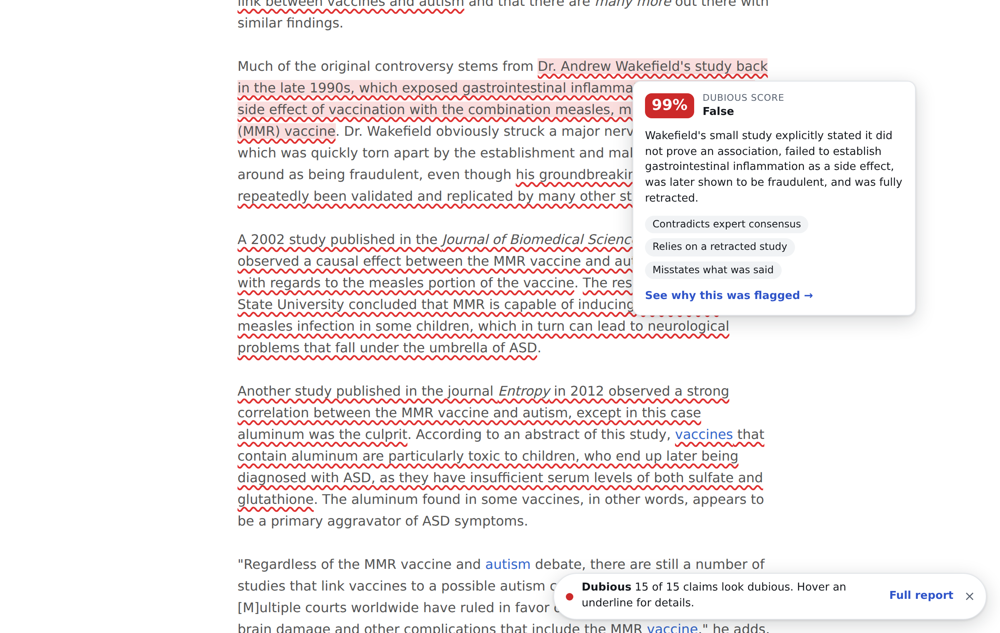

# Dubious

A Chrome extension that scans the page you are on, picks out its factual claims, and puts a wavy underline under the ones that do not hold up. Hover an underline for the score; click through for the evidence behind it.



A demonstration article written for the project, with true and false statements mixed. The four accurate statements are left alone and five claims are underlined.

## What this repository is

This is a demonstration copy of a working prototype. It contains the extension and most of the backend, with one part left out on purpose.

| Published here | Kept private |
|---|---|
| The Chrome extension (`extension/`) | The model prompts |
| Scan orchestration, caching and the local API (`dubious/pipeline.py`, `dubious/store.py`, `server/`) | The rules that turn research into a score |
| The fetcher for links a page cites (`dubious/sourcing.py`) | The full registry of source tiers |
| Quote location and claim placement (`dubious/textmatch.py`, `dubious/extract.py`) | |
| The model wrapper (`dubious/llm.py`) | |
| The report pages (`server/static/`) | |
| Unit tests for the fetcher, quote location and claim placement, and the browser end-to-end harness | |

Two stand-ins mark where the private part plugs in: `dubious/assess.py` is a stub, and the prompt in `dubious/extract.py` is empty. Because of that, **this copy does not run a scan end to end.** The unit tests published here do run.

## How a scan works

1. **The extension reads the page** when you press Scan, and not before. It collects the visible article text as ordered paragraphs with the links inside each one.
2. **The backend extracts the checkable claims** with one model call. Each claim comes back with the exact words that state it, and the backend finds those words in the page text so the extension can underline them.
3. **Each claim is researched** with a model call that uses live web search, and the pages the article itself cites are fetched and read.
4. **Each claim gets a score from 1 to 99.** The model labels what it found; fixed arithmetic turns the labels into the number, so the same findings always give the same score. This step is the private part.
5. **The extension underlines** claims at or above a threshold (40 by default) and links each one to a report page with the reasons and the sources found.

<p>
  
  
</p>

The report for one claim (left) and for a whole page (right). The claim report image leaves out its score breakdown.

## Parts worth reading

- **Reading a page so the marks land in the right place** (`extension/content.js`). The page is read as runs of inline text, and each claim is placed by character offset into the run it came from. The walk is written so that re-reading a run gives the same text after earlier marks have split its text nodes. Pages whose body is one `<form>`, paragraphs separated by `<br><br>`, and old-style footnote anchors are handled.
- **Offsets across two languages** (`_to_u16` in `dubious/extract.py`, `tests/test_extract.py`). Python indexes strings by code point and the browser by UTF-16 unit, so an emoji before a claim used to shift its underline by one character. Offsets are converted at the boundary.
- **Fetching links that an untrusted page chose** (`dubious/sourcing.py`, `tests/test_sourcing.py`). Hosts are resolved once and the connection is pinned to the address that was checked, which closes the DNS-rebinding gap. Redirects are re-checked hop by hop, compressed bodies are inflated under a size cap, and each fetch has one overall deadline.
- **Finding a model's quote in the real text** (`dubious/textmatch.py`). Models normalise whitespace, swap curly quotes, drop a full stop or elide the middle of a sentence. `locate` tolerates those and answers in offsets of the original text.
- **Getting the model to actually search** (`dubious/llm.py`). With a response schema set, the model usually answered from memory and skipped the web search (1 search in 7 calls, against 9 in 9 without a schema). Research and labelling are therefore separate calls, and a reply with no search behind it is treated as unverified.
- **Counting failures honestly** (`dubious/pipeline.py`). A claim whose check failed is reported as not checked, never as passed, and model spend is recorded even when a later step fails.
- **A local API that other websites cannot drive** (`server/app.py`). It is started on loopback only (`scripts/run.sh`), checks the Host header, sends no CORS headers, and serves report pages under a strict content security policy.
- **A browser test of the real thing** (`tests/e2e/run_e2e.py`). It loads the unpacked extension in headless Chromium, triggers a scan the way the popup does, and checks the underlines, the hover card and the report pages.

## Results in testing

| Page scanned | Claims found | Flagged |
|---|---|---|
| NaturalNews: an article saying studies prove vaccines cause autism | 15 | 15 |
| A vaccine-sceptic site: an article on rising autism rates, with 24 outside citations | 29 | 24 |
| The demonstration article, true and false statements mixed | 9 | 5 |
| CDC: About Measles, scanned as a control | 7 to 12 | 0 |

Measured on 15 November 2026. Flagged means the prototype scored the claim 40 or higher. It is an automated result, not a finding that the claim is false. The number of claims found on a page varies a little between scans, which is why the control shows a range.



A saved copy of the NaturalNews article, with the site's side columns hidden. The article is third-party content and is not in this repository; `scripts/snapshot.py` recreates the saved copy. Its text belongs to its publisher and is shown only to illustrate the tool.

## Running the tests

```bash
uv sync
uv run pytest
```

The tests need no network and no API key. The end-to-end harness and the scripts that run scans (`run.sh`, `scan_fixture.py`, `make_screenshots.py`) need the private parts and a Gemini key, so they are here to read rather than to run.

## Limits

- **It can be wrong.** Verdicts come from a language model reading search results, which is why every flag shows its evidence.
- **It has been tested on one subject so far.** Every test page was about vaccines and autism.
- **It sends the page's text, title and web address to Google's Gemini service** when you press Scan, and fetches the pages the article links to.
- **Long pages are cut off** at about 32,000 characters and 30 claims per scan.

## Licence

All rights reserved. See [`LICENSE`](LICENSE). The code is published to be read, not reused: beyond viewing and forking on GitHub, which GitHub's terms allow for any public repository, no licence is granted.
